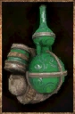

# Preservation Backpack

<!-- Généré depuis docs/data/owd-boutique.json ; modifier la Boutique. -->

{ .equipment-portrait }

**Catégorie :** Rangement  
**Famille :** Backpacks  
**Origine :** Outward

Elite bag that strongly slows down the decay of the food it contains.
Equipping this backpack slows your dodge and removes your dodge invincibility

| Caractéristique | Valeur |
| --- | --- |
| Poids (kg) | 3 |
| Volume (L) | 75 |
| Taille | Petite |
| Mains | 1 |
| Achat (argent) | 200 |
| Vente (argent) | 60 |
| Capacité (L) | 70 |
| Taille maximale acceptée | Petite |
| Accroches | 5 |
| Taille maximale aux accroches | Moyenne |
| Périssement ralenti (%) | 75 |

[Retour au catalogue](../equipement.md)
