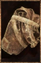

# Primitive Satchel

<!-- Généré depuis docs/data/owd-boutique.json ; modifier la Boutique. -->

{ .equipment-portrait }

**Catégorie :** Rangement  
**Famille :** Backpacks  
**Origine :** Outward

Basic craftable bag used to store items, though it lacks a spot to hang a lantern from.
Equipping this backpack slows your dodge.

| Caractéristique | Valeur |
| --- | --- |
| Poids (kg) | 1 |
| Volume (L) | 2 |
| Taille | Très petite |
| Mains | 1 |
| Achat (argent) | 30 |
| Vente (argent) | 9 |
| Capacité (L) | 20 |
| Taille maximale acceptée | Très petite |
| Accroches | 0 |
| Taille maximale aux accroches | Moyenne |

[Retour au catalogue](../equipement.md)
