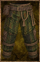

# Adventurer Trousers

<!-- Généré depuis docs/data/owd-boutique.json ; modifier la Boutique. -->

{ .equipment-portrait }

**Catégorie :** Bas  
**Famille :** Adventurer Set  
**Origine :** Homebrew

| Caractéristique | Valeur |
| --- | --- |
| Poids (kg) | 3 |
| Volume (L) | 3 |
| Taille | Très petite |
| Mains | 1 |
| Achat (argent) | 164 |
| Vente (argent) | 53 |
| Protection contre le froid | 4 |
| Protection contre la chaleur | 7 |
| Poches (L) | 0 |
| Protection Physique | 1 |
| Résistance Physique (%) | 10 |
| Résistance Feu (%) | 17 |
| Coût PM (%) | 4 |
| Coût PE (%) | 2 |
| Déplacement (%) | -2 |

[Retour au catalogue](../equipement.md)
