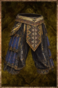

# Entomber Trousers

<!-- Généré depuis docs/data/owd-boutique.json ; modifier la Boutique. -->

{ .equipment-portrait }

**Catégorie :** Bas  
**Famille :** Entomber Set  
**Origine :** Homebrew

A garment covering the lower body.

| Caractéristique | Valeur |
| --- | --- |
| Poids (kg) | 2 |
| Volume (L) | 3 |
| Taille | Très petite |
| Mains | 1 |
| Achat (argent) | 218 |
| Vente (argent) | 69 |
| Protection contre le froid | 0 |
| Protection contre la chaleur | 9 |
| Poches (L) | 0 |
| Résistance Physique (%) | 13 |
| Résistance Éclair (%) | 18 |
| Résistance Décomposition (%) | 18 |
| Coût PE (%) | -4 |
| Déplacement (%) | 4 |

[Retour au catalogue](../equipement.md)
