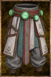

# Jade-Lich Trousers

<!-- Généré depuis docs/data/owd-boutique.json ; modifier la Boutique. -->

{ .equipment-portrait }

**Catégorie :** Bas  
**Famille :** Jade-Lich Set  
**Origine :** Homebrew

| Caractéristique | Valeur |
| --- | --- |
| Poids (kg) | 1 |
| Volume (L) | 2.5 |
| Taille | Très petite |
| Mains | 1 |
| Achat (argent) | 287 |
| Vente (argent) | 91 |
| Protection contre le froid | 0 |
| Protection contre la chaleur | 0 |
| Poches (L) | 0 |
| Résistance Physique (%) | 9 |
| Résistance Éclair (%) | -12 |
| Résistance Décomposition (%) | 20 |
| Bonus Feu (%) | 3 |
| Bonus Décomposition (%) | 10 |
| Coût PM (%) | -17 |

[Retour au catalogue](../equipement.md)
