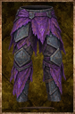

# Manawall Leg Armor

<!-- Généré depuis docs/data/owd-boutique.json ; modifier la Boutique. -->

{ .equipment-portrait }

**Catégorie :** Bas  
**Famille :** Manawall Set  
**Origine :** Homebrew

A garment covering the lower body.

| Caractéristique | Valeur |
| --- | --- |
| Poids (kg) | 1 |
| Volume (L) | 7 |
| Taille | Très petite |
| Mains | 1 |
| Achat (argent) | 322 |
| Vente (argent) | 96.4 |
| Protection contre le froid | 0 |
| Protection contre la chaleur | 4 |
| Poches (L) | 0 |
| Protection Physique | 3 |
| Résistance Physique (%) | 9 |
| Protection Feu | 5 |
| Protection Froid | 5 |
| Protection Éclair | 5 |
| Protection Décomposition | 5 |
| Protection Éthéré | 5 |
| Bonus Éthéré (%) | 9 |
| Déplacement (%) | 7 |

[Retour au catalogue](../equipement.md)
