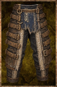

# Scavenger Trousers

<!-- illustration -->
{ .equipment-portrait }
<!-- /illustration -->

**Catégorie :** Bas  
**Famille :** Scavenger Set  
**Origine :** Créé pour le JDR

| Caractéristique | Valeur |
| --- | --- |
| Poids (kg) | 2,5 |
| Volume (L) | 3 |
| Construction | Souple |
| Achat (argent) | 28 |
| Vente (argent) | 9 |
| Protection | 0 |
| Résistance physique (%) | 6 |
| Résistance feu (%) | 0 |
| Résistance froid (%) | 0 |
| Résistance foudre (%) | 0 |
| Résistance décomposition (%) | 0 |
| Résistance éthéré (%) | 0 |
| Protection contre le froid | 4 |
| Protection contre la chaleur | 0 |
| Bonus physique (%) | 0 |
| Bonus feu (%) | 0 |
| Bonus froid (%) | 0 |
| Bonus foudre (%) | 0 |
| Bonus décomposition (%) | 0 |
| Bonus éthéré (%) | 0 |
| Coût de mana (%) | 0 |
| Coût d’endurance (%) | 0 |
| Vitesse (%) | 0 |
| Barrière | 0 |
| Réduction des délais (%) | 0 |
| Résistance à la corruption (%) | 0 |
| Résistance aux statuts (%) | 0 |
| Poches supplémentaires (kg) | 0 |

[Retour au catalogue](../equipement.md)
