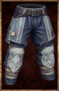

# Squire Trousers

<!-- Généré depuis docs/data/owd-boutique.json ; modifier la Boutique. -->

{ .equipment-portrait }

**Catégorie :** Bas  
**Famille :** Squire Set  
**Origine :** Homebrew

| Caractéristique | Valeur |
| --- | --- |
| Poids (kg) | 2.5 |
| Volume (L) | 2.5 |
| Taille | Très petite |
| Mains | 1 |
| Achat (argent) | 408 |
| Vente (argent) | 123 |
| Protection contre le froid | 2 |
| Protection contre la chaleur | 2 |
| Poches (L) | 0 |
| Résistance Physique (%) | 12 |
| Résistance Feu (%) | 4 |
| Résistance Froid (%) | 4 |
| Résistance Éclair (%) | 4 |
| Résistance Décomposition (%) | 4 |
| Résistance Éthéré (%) | 4 |
| Coût PE (%) | -13 |
| Déplacement (%) | 4 |

[Retour au catalogue](../equipement.md)
