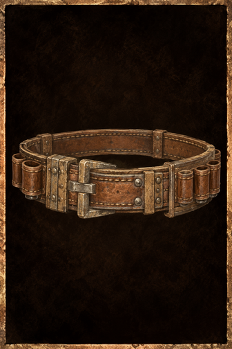

# Alchemist Belt

<!-- Généré depuis docs/data/owd-boutique.json ; modifier la Boutique. -->

{ .equipment-portrait }

**Catégorie :** Rangement  
**Famille :** Alchemist  
**Origine :** Homebrew

A waist belt with loops for small tools and supplies.

| Caractéristique | Valeur |
| --- | --- |
| Poids (kg) | 0.35 |
| Volume (L) | 0.7 |
| Taille | Minuscule |
| Mains | 1 |
| Achat (argent) | 70 |
| Vente (argent) | 23 |
| Accroches | 14 |
| Taille maximale aux accroches | Très petite |

[Retour au catalogue](../equipement.md)
