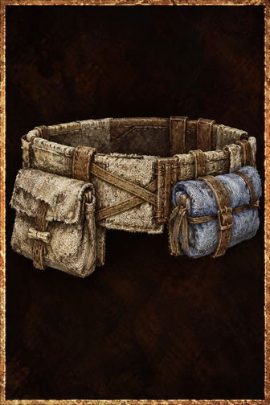

# Trader Warbelt

<!-- Généré depuis docs/data/owd-boutique.json ; modifier la Boutique. -->

{ .equipment-portrait }

**Catégorie :** Rangement  
**Famille :** Trader  
**Origine :** Homebrew

| Caractéristique | Valeur |
| --- | --- |
| Poids (kg) | 0.65 |
| Volume (L) | 1.3 |
| Taille | Minuscule |
| Mains | 1 |
| Achat (argent) | 110 |
| Vente (argent) | 36 |
| Accroches | 20 |
| Taille maximale aux accroches | Petite |

[Retour au catalogue](../equipement.md)
