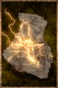

# Bolt Rag

<!-- Généré depuis docs/data/owd-boutique.json ; modifier la Boutique. -->

{ .equipment-portrait }

**Catégorie :** Consommables · Solide  
**Famille :** Supplies  
**Origine :** Outward

Soiled Cloth that confers the Lightning element when rubbed on a melee weapon.

| Caractéristique | Valeur |
| --- | --- |
| Poids (kg) | 0.2 |
| Volume (L) | 0.4 |
| Taille | Minuscule |
| Mains | 1 |
| Achat (argent) | 15 |
| Vente (argent) | 4 |
| Temps (DA) | 1 |
| Effet 1 | Imprégnation de foudre — Ajoute des dégâts de foudre égaux à 10 % des dégâts de base de l'arme, plus 5 dégâts de foudre. (15 secondes) |

[Retour au catalogue](../equipement.md)
