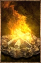

# Campfire Kit

<!-- Généré depuis docs/data/owd-boutique.json ; modifier la Boutique. -->

{ .equipment-portrait }

**Catégorie :** Cuisine et alchimie  
**Famille :** feu-de-camp  
**Origine :** Outward

A kit used to set up a fire for cooking, boiling water and keeping warm.

| Caractéristique | Valeur |
| --- | --- |
| Poids (kg) | 0.5 |
| Volume (L) | 1.5 |
| Taille | Minuscule |
| Mains | 1 |
| Achat (argent) | Non commercialisé |
| Vente (argent) | Non commercialisé |

[Retour au catalogue](../equipement.md)
