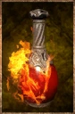

# Fire Varnish

<!-- Généré depuis docs/data/owd-boutique.json ; modifier la Boutique. -->

{ .equipment-portrait }

**Catégorie :** Consommables · Liquide  
**Famille :** Supplies  
**Origine :** Outward

Thick fluid that confers the Fire element when applied to a melee weapon.

| Caractéristique | Valeur |
| --- | --- |
| Poids (kg) | 0.25 |
| Volume (L) | 0.25 |
| Taille | Minuscule |
| Mains | 1 |
| Achat (argent) | 40 |
| Vente (argent) | 12 |
| Temps (DA) | 1 |
| Effet 1 | Imprégnation de feu supérieure — Ajoute des dégâts de feu égaux à 10 % des dégâts de base de l'arme, plus 12 dégâts de feu ; +4 points d'accumulation de brûlure par touche. (1 minute) |

[Retour au catalogue](../equipement.md)
