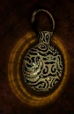

# Djinn's Lamp

<!-- Généré depuis docs/data/owd-boutique.json ; modifier la Boutique. -->

{ .equipment-portrait }

**Catégorie :** Éclairage  
**Famille :** Adventuring gear  
**Origine :** Outward

When held in hand, helps protect the wielder from Status Ailments. Can be refilled with thick oil.

| Caractéristique | Valeur |
| --- | --- |
| Poids (kg) | 1 |
| Volume (L) | 2 |
| Taille | Très petite |
| Mains | 1 |
| Achat (argent) | 25 |
| Vente (argent) | 8 |
| Autonomie | 8 hours |
| Recharge | Thick Oil |
| Effet 1 | Résistance de la lampe du Djinn — +15 % de résistance à l'accumulation des altérations. (Tant que tenue en main secondaire) |

[Retour au catalogue](../equipement.md)
