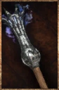

# Ice-Flame Torch

<!-- Généré depuis docs/data/owd-boutique.json ; modifier la Boutique. -->

{ .equipment-portrait }

**Catégorie :** Éclairage  
**Famille :** Adventuring gear  
**Origine :** Outward

Alchemical torch that cools the wielder even in sweltering temperatures.

| Caractéristique | Valeur |
| --- | --- |
| Poids (kg) | 0.4 |
| Volume (L) | 0.8 |
| Taille | Petite |
| Mains | 1 |
| Achat (argent) | 20 |
| Vente (argent) | 6 |
| Autonomie | 2 hours |
| Recharge | None |
| Effet 1 | Refroidissement de torche de glace — Refroidit le porteur ; Outward : effet thermique de −8 à −14 (unité du jeu). (Tant qu'allumée et tenue en main) — gestion manuelle |

[Retour au catalogue](../equipement.md)
