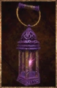

# Lantern of Souls

<!-- Généré depuis docs/data/owd-boutique.json ; modifier la Boutique. -->

{ .equipment-portrait }

**Catégorie :** Éclairage  
**Famille :** Adventuring gear  
**Origine :** Outward

Unique lantern with a purple glow, endless light, and resistances when held in the off hand.

| Caractéristique | Valeur |
| --- | --- |
| Poids (kg) | 1 |
| Volume (L) | 2 |
| Taille | Très petite |
| Mains | 1 |
| Achat (argent) | Non commercialisé |
| Vente (argent) | Non commercialisé |
| Autonomie | Infinie |
| Accrochable | Oui |
| Recharge | None |
| Effet 1 | Protection de la lanterne des âmes — +20 % de résistance éthérée ; +10 % de résistance au feu, à la glace, à la foudre et à la décomposition. (Tant que tenue en main secondaire) |

[Retour au catalogue](../equipement.md)
