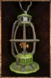

# Old Lantern

<!-- Généré depuis docs/data/owd-boutique.json ; modifier la Boutique. -->

{ .equipment-portrait }

**Catégorie :** Éclairage  
**Famille :** Adventuring gear  
**Origine :** Outward

Rusty oil lantern with a weak flame.

| Caractéristique | Valeur |
| --- | --- |
| Poids (kg) | 0.6 |
| Volume (L) | 1.2 |
| Taille | Très petite |
| Mains | 1 |
| Achat (argent) | 15 |
| Vente (argent) | 4 |
| Autonomie | 4 hours |
| Accrochable | Oui |
| Recharge | Thick Oil |

[Retour au catalogue](../equipement.md)
