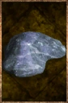

# Thick Oil

<!-- Généré depuis docs/data/owd-boutique.json ; modifier la Boutique. -->

{ .equipment-portrait }

**Catégorie :** Consommables · Pâte  
**Famille :** Food and supplies  
**Origine :** Outward

Thick combustible oil used to refuel compatible lanterns.

| Caractéristique | Valeur |
| --- | --- |
| Poids (kg) | 0.1 |
| Volume (L) | 0.1 |
| Taille | Minuscule |
| Mains | 1 |
| Achat (argent) | Non renseigné |
| Vente (argent) | Non renseigné |
| Temps (DA) | 0 |

[Retour au catalogue](../equipement.md)
