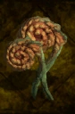

# Greasy Fern

<!-- Généré depuis docs/data/owd-boutique.json ; modifier la Boutique. -->

{ .equipment-portrait }

**Catégorie :** Matériaux et ingrédients  
**Famille :** Organique souple / végétal  
**Origine :** Outward

Rare plants that grow on mountains and used in alchemy.

| Caractéristique | Valeur |
| --- | --- |
| Poids (kg) | 0.3 |
| Volume (L) | 1 |
| Taille | Minuscule |
| Mains | 1 |
| Achat (argent) | 30 |
| Vente (argent) | 9 |

[Retour au catalogue](../equipement.md)
