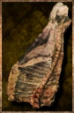

# Cooked Alpha Meat

<!-- Généré depuis docs/data/owd-boutique.json ; modifier la Boutique. -->

{ .equipment-portrait }

**Catégorie :** Consommables · Solide  
**Famille :** Food and drink  
**Origine :** Outward

| Caractéristique | Valeur |
| --- | --- |
| Poids (kg) | 0.4 |
| Volume (L) | 0.4 |
| Taille | Minuscule |
| Mains | 1 |
| Achat (argent) | Non renseigné |
| Vente (argent) | Non renseigné |
| Contenance | 8 |
| PS | 60 |
| PH | 15 |
| Temps (DA) | 2 |
| Effet 1 | Récupération Nourriture PV III — Niveau TTRPG 8 : +20 par heure (PV), en supplément de la récupération naturelle. (2 heures) |
| Effet 2 | Rage — +2 difficulté de Parade contre les attaques du personnage ; n'affecte pas l'Esquive. (10 minutes) |

[Retour au catalogue](../equipement.md)
