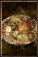

# Food Waste

<!-- Généré depuis docs/data/owd-boutique.json ; modifier la Boutique. -->

{ .equipment-portrait }

**Catégorie :** Consommables · Solide  
**Famille :** Food and drink  
**Origine :** Outward

Food.

| Caractéristique | Valeur |
| --- | --- |
| Poids (kg) | 0.1 |
| Volume (L) | 0.1 |
| Taille | Minuscule |
| Mains | 1 |
| Achat (argent) | Non renseigné |
| Vente (argent) | Non renseigné |
| Contenance | 2 |
| PS | 5 |
| PH | 5 |
| Temps (DA) | 1 |
| Condition : Indigestion | PS ≤ 8 % |
| Condition : Poison | PS ≤ 8 % |
| Effet 1 | Indigestion — Donne Indigestion. (Jusqu’à guérison) — gestion manuelle |
| Effet 2 | Poison — 5 dégâts par round. (1 minute) — gestion manuelle |

[Retour au catalogue](../equipement.md)
