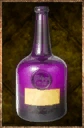

# Gaberry Wine

<!-- Généré depuis docs/data/owd-boutique.json ; modifier la Boutique. -->

{ .equipment-portrait }

**Catégorie :** Consommables · Liquide  
**Famille :** Food and drink  
**Origine :** Outward

| Caractéristique | Valeur |
| --- | --- |
| Poids (kg) | 0.5 |
| Volume (L) | 0.5 |
| Taille | Minuscule |
| Mains | 1 |
| Achat (argent) | Non renseigné |
| Vente (argent) | Non renseigné |
| Contenance | 10 |
| PS | 20 |
| PH | 25 |
| Temps (DA) | 2 |
| Effet 1 | Effondrement d’alcool +1 — Ajoute 1 niveau d’effondrement d’alcool. Ce niveau disparaît au bout de 2 heures. (2 heures) |

[Retour au catalogue](../equipement.md)
