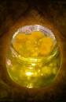

# Golden Jam

<!-- Généré depuis docs/data/owd-boutique.json ; modifier la Boutique. -->

{ .equipment-portrait }

**Catégorie :** Consommables · Pâte  
**Famille :** Food and drink  
**Origine :** Outward

Mashed and preserved Golden Crescent.

| Caractéristique | Valeur |
| --- | --- |
| Poids (kg) | 0.5 |
| Volume (L) | 0.4 |
| Taille | Minuscule |
| Mains | 1 |
| Achat (argent) | Non renseigné |
| Vente (argent) | Non renseigné |
| Contenance | 8 |
| PS | 70 |
| PH | 10 |
| Temps (DA) | 2 |
| Effet 1 | Récupération Nourriture PE II — Niveau TTRPG 9 : +5 toutes les 10 minutes (PE), en supplément de la récupération naturelle. (2 heures) |

[Retour au catalogue](../equipement.md)
