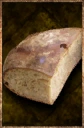

# Whole Loaf

<!-- Généré depuis docs/data/owd-boutique.json ; modifier la Boutique. -->

{ .equipment-portrait }

**Catégorie :** Consommables · Solide  
**Famille :** Food and drink  
**Origine :** Homebrew

Food.

| Caractéristique | Valeur |
| --- | --- |
| Poids (kg) | 1 |
| Volume (L) | 2 |
| Taille | Minuscule |
| Mains | 1 |
| Achat (argent) | 1 |
| Vente (argent) | 0.33 |
| Contenance | 40 |
| PS | 150 |
| PH | 25 |
| Temps (DA) | 5 |

[Retour au catalogue](../equipement.md)
