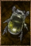

# Ochre Spice Beetle

<!-- Généré depuis docs/data/owd-boutique.json ; modifier la Boutique. -->

{ .equipment-portrait }

**Catégorie :** Consommables · Solide  
**Famille :** Food and drink  
**Origine :** Outward

An uncommon invigorating plant-dwelling insect used in elaborate recipes.

| Caractéristique | Valeur |
| --- | --- |
| Poids (kg) | 0.1 |
| Volume (L) | 0.1 |
| Taille | Minuscule |
| Mains | 1 |
| Achat (argent) | Non renseigné |
| Vente (argent) | Non renseigné |
| Contenance | 2 |
| PS | 10 |
| PH | 5 |
| Temps (DA) | 1 |
| Effet 1 | Protection contre le froid — +15 protection contre le froid. (2 heures) |

[Retour au catalogue](../equipement.md)
