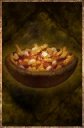

# Poutine

<!-- Généré depuis docs/data/owd-boutique.json ; modifier la Boutique. -->

{ .equipment-portrait }

**Catégorie :** Consommables · Solide  
**Famille :** Food and drink  
**Origine :** Outward

| Caractéristique | Valeur |
| --- | --- |
| Poids (kg) | 0.5 |
| Volume (L) | 0.5 |
| Taille | Minuscule |
| Mains | 1 |
| Achat (argent) | Non renseigné |
| Vente (argent) | Non renseigné |
| Contenance | 10 |
| PS | 70 |
| PH | 15 |
| Temps (DA) | 2 |
| Restauration PR | -25 points |
| Effet 1 | Protection contre le froid — +15 protection contre le froid. (2 heures) |
| Effet 2 | Impact augmenté — +2 difficulté de Parade contre les attaques du personnage ; n'affecte pas l'Esquive. (1 minute) |
| Effet 3 | Attaque physique augmentée — Nourriture — +20 % de dégâts physiques. (10 minutes) |

[Retour au catalogue](../equipement.md)
