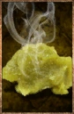

# Pungent Paste

<!-- Généré depuis docs/data/owd-boutique.json ; modifier la Boutique. -->

{ .equipment-portrait }

**Catégorie :** Consommables · Pâte  
**Famille :** Food and drink  
**Origine :** Outward

Odorous paste which restores your maximum health and stamina, allowing you to continue adventuring without sleep. It also instantly cures infections.

| Caractéristique | Valeur |
| --- | --- |
| Poids (kg) | 0.2 |
| Volume (L) | 0.2 |
| Taille | Minuscule |
| Mains | 1 |
| Achat (argent) | Non renseigné |
| Vente (argent) | Non renseigné |
| Contenance | 4 |
| PS | 20 |
| PH | 5 |
| Temps (DA) | 1 |
| Restauration PE | 70 points |
| Effet 1 | Effondrement de satiété ignoré — 4 niveaux — Ignore les effets de 4 niveaux d'effondrement de satiété ; l'effondrement réel reste inchangé. (2 heures) |
| Effet 2 | Effondrement d'hydratation ignoré — 4 niveaux — Ignore les effets de 4 niveaux d'effondrement d'hydratation ; l'effondrement réel reste inchangé. (2 heures) |
| Effet 3 | Traitement de l’infection — Traitement de l’infection. (À définir) — gestion manuelle |

[Retour au catalogue](../equipement.md)
