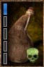

# Rancid Water

<!-- Généré depuis docs/data/owd-boutique.json ; modifier la Boutique. -->

{ .equipment-portrait }

**Catégorie :** Consommables · Liquide  
**Famille :** Food and drink  
**Origine :** Outward

Foul water found in places such as the Hallowed Marsh, liable to cause illness.

| Caractéristique | Valeur |
| --- | --- |
| Poids (kg) | 0.25 |
| Volume (L) | 0.25 |
| Taille | Minuscule |
| Mains | 1 |
| Achat (argent) | Non renseigné |
| Vente (argent) | Non renseigné |
| Contenance | 5 |
| PS | 0 |
| PH | 15 |
| Temps (DA) | 1 |
| Condition : Indigestion | PS ≤ 8 % |
| Effet 1 | Indigestion — Donne Indigestion. (Jusqu’à guérison) — gestion manuelle |
| Effet 2 | Récupération Eau ordinaire PE — Niveau TTRPG 10 : +10 PE toutes les 10 minutes. (10 minutes) |
| Effet 3 | Protection chaleur des eaux — +10 protection contre la chaleur. (10 minutes) |
| Effet 4 | Suppression de Burning — Supprime immédiatement Burning. (Instantané) |

[Retour au catalogue](../equipement.md)
