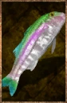

# Raw Rainbow Trout

<!-- Généré depuis docs/data/owd-boutique.json ; modifier la Boutique. -->

{ .equipment-portrait }

**Catégorie :** Consommables · Solide  
**Famille :** Food and drink  
**Origine :** Outward

A shimmering fish that aids mana recovery, but may cause illness when eaten raw.

| Caractéristique | Valeur |
| --- | --- |
| Poids (kg) | 0.5 |
| Volume (L) | 0.5 |
| Taille | Minuscule |
| Mains | 1 |
| Achat (argent) | Non renseigné |
| Vente (argent) | Non renseigné |
| Contenance | 10 |
| PS | 40 |
| PH | 25 |
| Temps (DA) | 2 |
| Condition : Indigestion | PS ≤ 8 % |
| Effet 1 | Récupération Nourriture PM II — Niveau TTRPG 7 : +15 par heure (PM), en supplément de la récupération naturelle. (2 heures) |
| Effet 2 | Résistance élémentaire — +20 % de résistance au feu, à la glace, à la foudre, à la décomposition et à l'éther. (1 minute) |
| Effet 3 | Indigestion — Donne Indigestion. (Jusqu’à guérison) — gestion manuelle |

[Retour au catalogue](../equipement.md)
