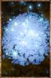

# Blue Sand

<!-- Généré depuis docs/data/owd-boutique.json ; modifier la Boutique. -->

{ .equipment-portrait }

**Catégorie :** Objets précieux  
**Famille :** Minéral / poudre  
**Origine :** Outward

Glimmering powder used by blacksmiths to craft armors made of blue steel alloy.
It is also highly prized as an alchemical ingredient.

| Caractéristique | Valeur |
| --- | --- |
| Poids (kg) | 0.2 |
| Volume (L) | 0.2 |
| Taille | Minuscule |
| Mains | 1 |
| Achat (argent) | 47 |
| Vente (argent) | 14 |

[Retour au catalogue](../equipement.md)
