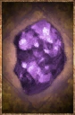

# Mana Stone

<!-- Généré depuis docs/data/owd-boutique.json ; modifier la Boutique. -->

{ .equipment-portrait }

**Catégorie :** Objets précieux  
**Famille :** Minéral / poudre  
**Origine :** Outward

A valuable trade good.

| Caractéristique | Valeur |
| --- | --- |
| Poids (kg) | 0.5 |
| Volume (L) | 0.4 |
| Taille | Minuscule |
| Mains | 1 |
| Achat (argent) | 20 |
| Vente (argent) | 6 |

[Retour au catalogue](../equipement.md)
