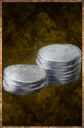

# Silver

<!-- Généré depuis docs/data/owd-boutique.json ; modifier la Boutique. -->

{ .equipment-portrait }

**Catégorie :** Objets précieux  
**Famille :** Monnaie  
**Origine :** Outward

Universal currency of the land.
Note that 100 coins have a combined weight of 1.

| Caractéristique | Valeur |
| --- | --- |
| Poids (kg) | 0.01 |
| Volume (L) | 0.01 |
| Taille | Minuscule |
| Mains | 1 |
| Achat (argent) | 1 |
| Vente (argent) | 1 |

[Retour au catalogue](../equipement.md)
