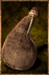

# Waterskin

<!-- Généré depuis docs/data/owd-boutique.json ; modifier la Boutique. -->

{ .equipment-portrait }

**Catégorie :** Contenants  
**Famille :** Containers  
**Origine :** Homebrew

An empty leather waterskin with a capacity of eight quarter-liter doses.

| Caractéristique | Valeur |
| --- | --- |
| Poids (kg) | 0.25 |
| Volume (L) | 0.5 |
| Taille | Minuscule |
| Mains | 1 |
| Achat (argent) | 6 |
| Vente (argent) | 2 |
| Capacité (L) | 2 |
| Contenu accepté | Liquide |
| Piles de contenu | 1 |
| Capacité (doses de 0,25 L) | 8 |

[Retour au catalogue](../equipement.md)
