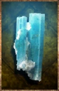

# Tiny Aquamarine

<!-- Généré depuis docs/data/owd-boutique.json ; modifier la Boutique. -->

{ .equipment-portrait }

**Catégorie :** Pierres précieuses  
**Famille :** Gemme  
**Origine :** Outward

Gemme compacte ; Tsar Stone non commercialisable

| Caractéristique | Valeur |
| --- | --- |
| Poids (kg) | 0.1 |
| Volume (L) | 0.1 |
| Taille | Minuscule |
| Mains | 1 |
| Achat (argent) | 20 |
| Vente (argent) | 20 |

[Retour au catalogue](../equipement.md)
