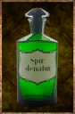

# Antidote

<!-- Généré depuis docs/data/owd-boutique.json ; modifier la Boutique. -->

{ .equipment-portrait }

**Catégorie :** Consommables · Liquide  
**Famille :** Food and drink  
**Origine :** Outward

| Caractéristique | Valeur |
| --- | --- |
| Poids (kg) | 0.25 |
| Volume (L) | 0.25 |
| Taille | Minuscule |
| Mains | 1 |
| Achat (argent) | 7 |
| Vente (argent) | 2 |
| Contenance | 5 |
| PS | 0 |
| PH | 15 |
| Temps (DA) | 1 |
| Effet 1 | Suppression du poison — Supprime tous les effets de poison, quelle que soit leur gravité. (Instantané) |

[Retour au catalogue](../equipement.md)
