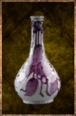

# Hex Cleaner

<!-- Généré depuis docs/data/owd-boutique.json ; modifier la Boutique. -->

{ .equipment-portrait }

**Catégorie :** Consommables · Liquide  
**Famille :** Food and drink  
**Origine :** Outward

A drink.

| Caractéristique | Valeur |
| --- | --- |
| Poids (kg) | 0.25 |
| Volume (L) | 0.25 |
| Taille | Minuscule |
| Mains | 1 |
| Achat (argent) | 35 |
| Vente (argent) | 10 |
| Contenance | 5 |
| PS | 0 |
| PH | 15 |
| Temps (DA) | 1 |
| Effet 1 | Dissipation des maléfices — Supprime les maléfices Chill, Curse, Doomed, Haunted, Scorched, ainsi que Pain, Confusion et The Hunch. (Instantané) |
| Effet 2 | Résistance aux altérations augmentée — +75 % de résistance à l'accumulation des altérations. Points reçus = arrondi supérieur de max(0, accumulation × 0,25). (1 minute) |

[Retour au catalogue](../equipement.md)
