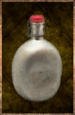

# Survivor Elixir

<!-- Généré depuis docs/data/owd-boutique.json ; modifier la Boutique. -->

{ .equipment-portrait }

**Catégorie :** Consommables · Liquide  
**Famille :** Food and drink  
**Origine :** Outward

Powerful concoction that restores stamina and burnt stamina, and provides protection from hot and freezing environments.

| Caractéristique | Valeur |
| --- | --- |
| Poids (kg) | 0.25 |
| Volume (L) | 0.25 |
| Taille | Minuscule |
| Mains | 1 |
| Achat (argent) | 60 |
| Vente (argent) | 18 |
| Contenance | 5 |
| PS | 0 |
| PH | 15 |
| Temps (DA) | 1 |
| Effet 1 | Effondrement d'hydratation ignoré — 4 niveaux — Ignore les effets de 4 niveaux d'effondrement d'hydratation ; l'effondrement réel reste inchangé. (2 heures) |
| Effet 2 | Protection climatique — +20 protection contre la chaleur, +20 protection contre le froid et +10 % de résistance à la décomposition. (2 heures) |
| Effet 3 | Récupération Potion PE III — Niveau TTRPG 18 : +10 PE/round, en supplément de la récupération naturelle. (1 minute) |

[Retour au catalogue](../equipement.md)
