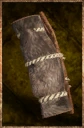

# Fur Tent

<!-- Généré depuis docs/data/owd-boutique.json ; modifier la Boutique. -->

{ .equipment-portrait }

**Catégorie :** Tentes et couchages  
**Famille :** Adventuring gear  
**Origine :** Outward

Layered tent of thick furs that grant high resistance to cold weather.
Sleeping in this tent gives a large bonus to stamina use.

| Caractéristique | Valeur |
| --- | --- |
| Poids (kg) | 6 |
| Volume (L) | 12 |
| Taille | Petite |
| Mains | 1 |
| Achat (argent) | 65 |
| Vente (argent) | 20 |
| Effet 1 | Sommeil : Fur Tent — +10 Cold Weather Def; −15% Stamina costs (40 minutes (Outward)) — gestion manuelle |

[Retour au catalogue](../equipement.md)
