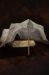

# Ice Totemic Lodge

<!-- Généré depuis docs/data/owd-boutique.json ; modifier la Boutique. -->

{ .equipment-portrait }

**Catégorie :** Tentes et couchages  
**Famille :** Adventuring gear  
**Origine :** Outward

Improves your Ice power, and weakens your Fire resistance.

| Caractéristique | Valeur |
| --- | --- |
| Poids (kg) | 5 |
| Volume (L) | 10 |
| Taille | Petite |
| Mains | 1 |
| Achat (argent) | 220 |
| Vente (argent) | 66 |
| Effet 1 | Sommeil : Ice Totemic Lodge — −15% Stamina costs; +10% Frost damage; −35% Fire resistance (40 minutes (Outward)) — gestion manuelle |

[Retour au catalogue](../equipement.md)
