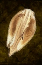

# Plant Tent

<!-- Généré depuis docs/data/owd-boutique.json ; modifier la Boutique. -->

{ .equipment-portrait }

**Catégorie :** Tentes et couchages  
**Famille :** Adventuring gear  
**Origine :** Outward

Wondrous shelter born of a seed, which protects against the heat and refills one's Thirst and hunger. This tent cannot be picked back up.

| Caractéristique | Valeur |
| --- | --- |
| Poids (kg) | 0.2 |
| Volume (L) | 0.4 |
| Taille | Minuscule |
| Mains | 1 |
| Achat (argent) | 8 |
| Vente (argent) | 2 |
| Effet 1 | Sommeil : Plant Tent — +10 Hot Weather Def (40 minutes (Outward)) — gestion manuelle |

[Retour au catalogue](../equipement.md)
