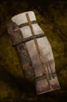

# Simple Tent

<!-- Généré depuis docs/data/owd-boutique.json ; modifier la Boutique. -->

{ .equipment-portrait }

**Catégorie :** Tentes et couchages  
**Famille :** Adventuring gear  
**Origine :** Outward

Well-made tent that helps protect against the weather, compared to a bedroll. Sleeping in this tent gives a small bonus to stamina use.

| Caractéristique | Valeur |
| --- | --- |
| Poids (kg) | 5 |
| Volume (L) | 10 |
| Taille | Petite |
| Mains | 1 |
| Achat (argent) | 32 |
| Vente (argent) | 10 |
| Effet 1 | Sommeil : Simple Tent — −5% Stamina costs (40 minutes (Outward)) — gestion manuelle |

[Retour au catalogue](../equipement.md)
