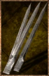

# Spikes – Iron

<!-- Généré depuis docs/data/owd-boutique.json ; modifier la Boutique. -->

{ .equipment-portrait }

**Catégorie :** Pièges et composants  
**Famille :** Traps and components  
**Origine :** Outward

Spikes that must be placed in a Tripwire Trap, inflicting moderate damage to enemies that step on it.

| Caractéristique | Valeur |
| --- | --- |
| Poids (kg) | 0.2 |
| Volume (L) | Non renseigné |
| Taille | Non renseignée |
| Mains | 1 |
| Achat (argent) | 3 |
| Vente (argent) | 1 |
| Effets JDR | Non définis |

[Retour au catalogue](../equipement.md)
