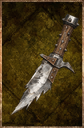

# Brutal Dagger

<!-- Généré depuis docs/data/owd-boutique.json ; modifier la Boutique. -->

{ .equipment-portrait }

**Catégorie :** Dagues  
**Famille :** Brutal  
**Origine :** Homebrew

A dagger crafted in the Brutal style.

| Caractéristique | Valeur |
| --- | --- |
| Poids (kg) | 1.5 |
| Volume (L) | 0.3 |
| Taille | Minuscule |
| Mains | 1 |
| Achat (argent) | 300 |
| Vente (argent) | 90 |
| Attaque | 6 |
| Touches | 1 |
| Dégâts de base | 35 |
| Parade | 5 |
| Réduction de base | 10 |
| Modificateur de dégâts 1 | DEX |
| Modificateur de dégâts 2 | DEX |
| Modificateur de réduction 1 | DEX |
| Physique (%) | 100 |
| Feu (%) | 0 |
| Froid (%) | 0 |
| Éclair (%) | 0 |
| Décomposition (%) | 0 |
| Éthéré (%) | 0 |
| DEX requise | 20 |

[Retour au catalogue](../equipement.md)
