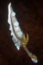

# Gilded Shiver of Tramontane

<!-- illustration -->
{ .equipment-portrait }
<!-- /illustration -->

**Catégorie :** Dagues  
**Famille :** Hors set  
**Origine :** Outward

A luxurious dagger from the far North, whose frigid cold can inflict Hamper, Slow, and Cripple on foes. Reduces your Fire resistance. Dagger skills are necessary to use this off-hand weapon.

| Caractéristique | Valeur |
| --- | --- |
| Poids (kg) | 0,4 |
| Volume (L) | 0,3 |
| Taille | Très petite |
| Achat (argent) | 2000 |
| Vente (argent) | 600 |
| Attaque | 7 |
| Touches | 1 |
| Dégâts de base | 55 |
| Modificateur de dégâts 1 | DEX |
| Modificateur de dégâts 2 | DEX |
| Parade | 6 |
| Réduction de base | 10 |
| Modificateur de réduction 1 | DEX |
| DEX requise | 20 |
| FOR requise | — |
| Physique (%) | 0,0 |
| Feu (%) | 0,0 |
| Froid (%) | 100,0 |
| Foudre (%) | 0,0 |
| Décomposition (%) | 0,0 |
| Éthéré (%) | 0,0 |

## Propriétés

Slow Down / Accumulation 60%
Crippled / Accumulation 45%
Hampered / Accumulation 35%
-15% Fire resistance

[Retour au catalogue](../equipement.md)
