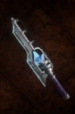

# Hailfrost Dagger

<!-- Généré depuis docs/data/owd-boutique.json ; modifier la Boutique. -->

{ .equipment-portrait }

**Catégorie :** Dagues  
**Famille :** Hailfrost  
**Origine :** Outward

Not enchantable and loses Durability over time. Can be repaired by crafting it with a Cold Stone. This off-hand weapon requires Dagger Skills to be used.

| Caractéristique | Valeur |
| --- | --- |
| Poids (kg) | 0.4 |
| Volume (L) | 0.2 |
| Taille | Minuscule |
| Mains | 1 |
| Achat (argent) | 2000 |
| Vente (argent) | 600 |
| Attaque | 8 |
| Touches | 1 |
| Dégâts de base | 90 |
| Parade | 7 |
| Réduction de base | 10 |
| Modificateur de dégâts 1 | DEX |
| Modificateur de dégâts 2 | DEX |
| Modificateur de réduction 1 | DEX |
| Physique (%) | 50 |
| Feu (%) | 0 |
| Froid (%) | 50 |
| Éclair (%) | 0 |
| Décomposition (%) | 0 |
| Éthéré (%) | 0 |
| DEX requise | 20 |
| Bonus Froid (%) | 5 |
| Propriété — gestion manuelle | Crippled / Buildup 60% |

[Retour au catalogue](../equipement.md)
