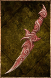

# Porcelain Dagger

<!-- illustration -->
{ .equipment-portrait }
<!-- /illustration -->

**Catégorie :** Dagues  
**Famille :** Porcelain  
**Origine :** Créé pour le JDR

| Caractéristique | Valeur |
| --- | --- |
| Poids (kg) | 0,4 |
| Volume (L) | 0,4 |
| Taille | Très petite |
| Achat (argent) | 2000 |
| Vente (argent) | 600 |
| Attaque | 7 |
| Touches | 1 |
| Dégâts de base | 90 |
| Modificateur de dégâts 1 | DEX |
| Modificateur de dégâts 2 | DEX |
| Parade | 6 |
| Réduction de base | 10 |
| Modificateur de réduction 1 | DEX |
| DEX requise | 20 |
| FOR requise | 0 |
| Physique (%) | 50,0 |
| Feu (%) | 0,0 |
| Froid (%) | 0,0 |
| Foudre (%) | 50,0 |
| Décomposition (%) | 0,0 |
| Éthéré (%) | 0,0 |

[Retour au catalogue](../equipement.md)
