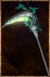

# Ghost Reaper

<!-- illustration -->
{ .equipment-portrait }
<!-- /illustration -->

**Catégorie :** Faux de guerre  
**Famille :** Ghost  
**Origine :** Outward

This ghostly scythe polearm hungrily rips and tears the souls of the wicked. Inflicts haunted.

| Caractéristique | Valeur |
| --- | --- |
| Poids (kg) | 5 |
| Volume (L) | 6 |
| Taille | Moyenne |
| Achat (argent) | 2500 |
| Vente (argent) | 750 |
| Attaque | 6 |
| Touches | 2 |
| Dégâts de base | 125 |
| Modificateur de dégâts 1 | FOR |
| Modificateur de dégâts 2 | FOR |
| Modificateur de dégâts 3 | DEX |
| Parade | 1 |
| Réduction de base | 20 |
| Modificateur de réduction 1 | FOR |
| Modificateur de réduction 2 | FOR |
| DEX requise | 10 |
| FOR requise | 20 |
| Physique (%) | 50,0 |
| Feu (%) | 0,0 |
| Froid (%) | 0,0 |
| Foudre (%) | 0,0 |
| Décomposition (%) | 50,0 |
| Éthéré (%) | 0,0 |

## Propriétés

Haunted / Accumulation 60%
Coût de mana : -15 %

[Retour au catalogue](../equipement.md)
