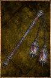

# Forged Glass Two-Handed Flail

<!-- Généré depuis docs/data/owd-boutique.json ; modifier la Boutique. -->

{ .equipment-portrait }

**Catégorie :** Fléaux à deux mains  
**Famille :** Forged Glass  
**Origine :** Homebrew

A two-handed flail crafted in the Forged Glass style.

| Caractéristique | Valeur |
| --- | --- |
| Poids (kg) | 4 |
| Volume (L) | 7 |
| Taille | Moyenne |
| Mains | 2 |
| Achat (argent) | 2500 |
| Vente (argent) | 750 |
| Attaque | 17 |
| Touches | 2 |
| Dégâts de base | 160 |
| Parade | 11 |
| Réduction de base | 30 |
| Modificateur de dégâts 1 | DEX |
| Modificateur de dégâts 2 | FOR |
| Modificateur de dégâts 3 | FOR |
| Modificateur de réduction 1 | FOR |
| Modificateur de réduction 2 | FOR |
| Physique (%) | 100 |
| Feu (%) | 0 |
| Froid (%) | 0 |
| Éclair (%) | 0 |
| Décomposition (%) | 0 |
| Éthéré (%) | 0 |
| FOR requise | 20 |
| DEX requise | 10 |
| Protection passive Feu | 1 |
| Protection passive Froid | 1 |
| Protection passive Éclair | 1 |
| Protection passive Décomposition | 1 |
| Protection passive Éthéré | 1 |

[Retour au catalogue](../equipement.md)
