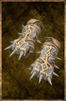

# Calygrey Knuckles

<!-- Généré depuis docs/data/owd-boutique.json ; modifier la Boutique. -->

{ .equipment-portrait }

**Catégorie :** Gantelets  
**Famille :** Calygrey  
**Origine :** Homebrew

| Caractéristique | Valeur |
| --- | --- |
| Poids (kg) | 1 |
| Volume (L) | 1.5 |
| Taille | Minuscule |
| Mains | 1 |
| Achat (argent) | 225 |
| Vente (argent) | 68 |
| Attaque | 7 |
| Touches | 1 |
| Dégâts de base | 35 |
| Parade | 6 |
| Réduction de base | 5 |
| Modificateur de dégâts 1 | FOR |
| Modificateur de dégâts 2 | FOR |
| Modificateur de réduction 1 | FOR |
| Physique (%) | 70 |
| Feu (%) | 0 |
| Froid (%) | 0 |
| Éclair (%) | 30 |
| Décomposition (%) | 0 |
| Éthéré (%) | 0 |
| FOR requise | 20 |

[Retour au catalogue](../equipement.md)
