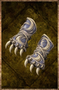

# Crescent Knuckles

<!-- Généré depuis docs/data/owd-boutique.json ; modifier la Boutique. -->

{ .equipment-portrait }

**Catégorie :** Gantelets  
**Famille :** Crescent  
**Origine :** Homebrew

A pair of knuckles crafted in the Crescent style.

| Caractéristique | Valeur |
| --- | --- |
| Poids (kg) | 0.5 |
| Volume (L) | 2 |
| Taille | Minuscule |
| Mains | 1 |
| Achat (argent) | 375 |
| Vente (argent) | 112 |
| Attaque | 5 |
| Touches | 1 |
| Dégâts de base | 30 |
| Parade | 4 |
| Réduction de base | 5 |
| Modificateur de dégâts 1 | FOR |
| Modificateur de dégâts 2 | FOR |
| Modificateur de réduction 1 | FOR |
| Physique (%) | 75 |
| Feu (%) | 0 |
| Froid (%) | 0 |
| Éclair (%) | 0 |
| Décomposition (%) | 0 |
| Éthéré (%) | 25 |
| FOR requise | 20 |
| Propriété — gestion manuelle | Elemental Vulnerability / Buildup 45% |

[Retour au catalogue](../equipement.md)
